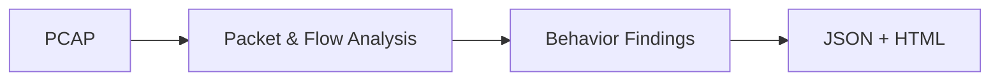

# 🔎 PCAP Behavior Core


PCAP Behavior Core is a Python command-line application for analyzing network
behavior in `.pcap` files. It generates a structured JSON file and a standalone
HTML report that can be opened without a server or internet connection.

## ✨ Features

- **TCP connection scanning patterns:** Repeated SYN attempts across destination ports or IP addresses, evaluated using target diversity, timing and observed responses.
- **Periodic TCP connections:** Repeated communications with measurable timing consistency.
- **DNS observations:** Matched DNS query/response records and concentrated NXDOMAIN activity.
- **Traffic observations:** Long-duration TCP flows and outbound traffic volumes.
- **FTP control observations:** Commands and server reply codes observed on TCP port 21. Credentials and file paths are excluded from the report.
- **Evidence details:** Connection counts, time windows, endpoints and linked packet references.

The tool does not use threat signatures, external threat-intelligence services or cloud APIs.

## 🔄 How It Works



The program reads packets, organizes traffic into flows, evaluates supported behavior patterns, and writes the analysis results to JSON and HTML files.
## 📦 Installation

**Requirements**
- Python 3.10 or newer
- Git (for cloning the repository)

Clone the repository:

```bash
git clone https://github.com/sacitcinar/pcap-behavior-core.git
cd pcap-behavior-core
```

Install PCAP Behavior Core:

```bash
python -m pip install .
```

## 🚀 Usage

Analyze a PCAP file:

```bash
python -m pcapcore capture.pcap
```

The analysis generates two files by default:

- `capture.pcap.observations.json` — Structured analysis results
- `capture.pcap.observations.html` — Standalone interactive HTML report

Specify a custom output path:

```bash
python -m pcapcore capture.pcap -o results/analysis.json
```

This generates `results/analysis.json` and `results/analysis.html`.

View all available command-line options:

```bash
python -m pcapcore --help
```

## 📊 Output

| File | Content |
| --- | --- |
| **JSON** | Structured capture summary, observations and finding previews. |
| **HTML** | Offline report with the full set of findings, supporting evidence and traffic tables. |

Open the `.html` file in any modern browser to inspect the results. Captures are processed locally.

## 📸 Screenshots
### Overview


### Behavior Findings


## 📁 Project Structure

```text
pcap-behavior-core/
├── pcapcore/
│   ├── __init__.py
│   ├── __main__.py
│   ├── artifacts.py
│   ├── beaconing.py
│   ├── cli.py
│   ├── context_pipeline.py
│   ├── correlation.py
│   ├── correlation_pipeline.py
│   ├── dashboard_data.py
│   ├── decoders.py
│   ├── detection_pipeline.py
│   ├── dns_behavior.py
│   ├── dns_events.py
│   ├── dns_pipeline.py
│   ├── engine.py
│   ├── episode_pipeline.py
│   ├── episodes.py
│   ├── features.py
│   ├── flows.py
│   ├── ftp_control.py
│   ├── host_dns_context.py
│   ├── pipeline.py
│   ├── reader.py
│   ├── report_html.py
│   ├── scan_pipeline.py
│   ├── scanning.py
│   ├── traffic_behavior.py
│   └── traffic_pipeline.py
├── pyproject.toml
├── README.md
├── LICENSE
└── .gitignore
```

## 📄 License

This project is licensed under the [MIT License](LICENSE).

## ⚠️ Disclaimer

PCAP Behavior Core reports observable network behavior, not confirmed attacks,
malware infections or malicious intent. Incomplete captures, encrypted traffic,
asymmetric visibility and legitimate automated traffic can affect the results.
A finding should be interpreted alongside other evidence. Reports can contain
capture-derived addresses and metadata; review them before sharing.
